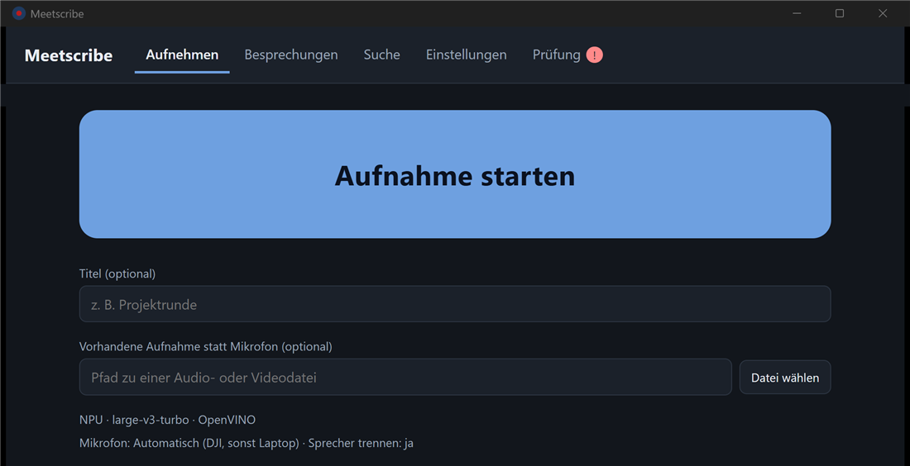

# meetscribe

## Was es ist

meetscribe ist eine Windows-App für Besprechungen. Ein Klick startet die Aufnahme. Danach transkribiert die App das Gespräch auf Deutsch, trennt die Sprecher, lässt dich ihnen Namen geben und schreibt ein Protokoll. Alles läuft offline auf dem eigenen Rechner. Die Spracherkennung (Whisper large-v3-turbo über OpenVINO) läuft bevorzugt auf der NPU eines Intel Core Ultra, mit Rückfall auf die integrierte GPU und die CPU.



Das Protokoll enthält Kopfdaten, eine Teilnehmertabelle (Redezeit, Anteil, Wörter) und das Transkript nach Sprechern. Es enthält keine Zusammenfassung und keine Aufgabenliste (siehe Hinweise). Alle Besprechungen landen in einem durchsuchbaren Archiv.

Die App ist eine Hülle um die Engine (ein Python-Programm namens `meetscribe`). Die Engine macht die Aufnahme, die Transkription und das Archiv. Die App startet sie einmal als Kindprozess, lässt sie laufen und schickt ihr alle Befehle über eine Leitung (JSON-RPC, siehe „Engine-Protokoll“).

## Installation

Die Installation hat zwei Teile, die du einmalig machst: zuerst die Engine mit den Modellen, dann die App. Der App-Installer enthält nur die App, keine Engine und keine Modelle.

### Voraussetzungen

- Windows 11 (64 Bit). Entwickelt und gemessen nur auf Windows 11 mit Core Ultra 7 258V, Arc 140V, 32 GB RAM.
- Intel Core Ultra mit NPU. Ohne NPU läuft es über den Fallback auf iGPU oder CPU. Optional (zweites Backend): eine NVIDIA-Karte mit CUDA 12 für faster-whisper auf der GPU; faster-whisper auf der CPU braucht nichts davon.

### Engine und Modelle

Die Engine richtest du einmalig im Projektordner ein: Python-Umgebung, ffmpeg, Treiber für NPU und Grafik, optional das Zugriffstoken für die Sprechertrennung und der Modell-Download. Das sind Eingaben in der Konsole und stehen deshalb im Entwicklerteil unter „Engine einrichten“. Weitere Whisper-Modelle lädst du danach in der App (Einstellungen, „Modell herunterladen“); der Reiter „Prüfung“ zeigt, was noch fehlt.

Speicherbedarf, gemessen im Projektordner: virtuelle Umgebung 1,4 GB, Whisper fp16 1,6 GB, Whisper int8 0,8 GB, Compile-Cache 3,8 GB. Die Größe des Diarisierungsmodells wurde nicht gemessen. Dazu kommen Aufnahmen: Audio wird nie gelöscht.

### App installieren

Den Installer `Meetscribe_0.1.0_x64-setup.exe` ausführen. Er enthält nur die Oberfläche. Wie du ihn aus dem Quellcode baust, steht unter „Für Fortgeschrittene“; er liegt danach in `gui\src-tauri\target\release\bundle\nsis\`.

Die App findet die Engine über ihre Einstellungen (Reiter „Einstellungen“, Abschnitt „Engine“). Mit der Engine-Installation steht `meetscribe` im PATH, und die App findet es von selbst (genaue Reihenfolge unter „Engine finden“). Findet sie die Engine nicht, trägst du dort den Pfad zu `meetscribe.exe` oder den Projektordner ein. Der Reiter „Prüfung“ zeigt, welche Engine läuft und was noch fehlt.

Deinstallieren: Der Deinstallationsdialog hat das Feld „Anwendungsdaten löschen“. Ohne Haken, und immer bei der stillen Deinstallation (`/S`), bleiben `HKCU\Software\meetscribe\Meetscribe` (der Installationspfad), `%APPDATA%\de.meetscribe.gui` (Einstellungen, `pending.json`, `engine.log`) und `%LOCALAPPDATA%\de.meetscribe.gui` (WebView2-Daten) zurück; so steht es in der Vorlage des Tauri-Installers (`installer.nsi`, tauri-bundler 2.10.4), eine stille Deinstallation hat genau diese Reste hinterlassen. Wer alles entfernen will, setzt den Haken oder löscht diese Einträge von Hand. Daten, Modelle und Protokolle der Engine liegen woanders und bleiben immer.

## Bedienung der App

Die App hat fünf Reiter: „Aufnehmen“, „Besprechungen“, „Suche“, „Einstellungen“ und „Prüfung“. Täglich genügt der erste.

### Aufnehmen

1. Auf „Aufnahme starten“ klicken. Optional vorher einen Titel eintragen (höchstens 80 Zeichen; ohne Angabe nimmt die App den Dateinamen der Aufnahme). Unter dem Knopf stehen zwei ruhige Zeilen mit der aktuellen Wahl, etwa „NPU · large-v3-turbo · OpenVINO“ und „Mikrofon: Automatisch (DJI, sonst Laptop) · Sprecher trennen: ja“.
2. Die App prüft zuerst alles Nötige („Prüfe Voraussetzungen“). Fehlt etwas, bricht sie ab und nimmt nichts auf. Danach zeigt sie „Aufnahme läuft“ mit der Zeit, dem Eingang („Eingang: <Name>“) und dem Pfad der Audiodatei.
3. Auf „Aufnahme beenden“ klicken. Die App speichert das Audio und transkribiert („Transkription und Sprechertrennung“, ohne Sprechertrennung „Transkription“). In der Zeile „Läuft auf“ steht, womit gerechnet wird.
4. Es erscheint „Fertig“ mit der Zahl der Abschnitte und der Sprecher und dem Pfad des Protokolls. Je erkanntem Sprecher zeigt die App das Label (`SPEAKER_00`, ...), den längsten Satz dieses Sprechers und ein Feld „Name (leer lassen = nicht ändern)“. Namen eintragen und auf „Namen speichern“ klicken; das Protokoll wird neu erzeugt („Namen gespeichert, Protokoll neu erzeugt.“). Wurden keine Sprecher getrennt, steht dort „Keine Sprecher getrennt. Das Protokoll ist fertig.“ `UNKNOWN` wird nicht abgefragt.
5. Auf „Protokoll öffnen“ klicken, um das Protokoll mit dem Standardprogramm zu öffnen. Es liegt als `protokolle\<Datum>_<Titel>.md` (bei gleichem Namen `-2`, `-3`, ...; UTF-8). „Neue Aufnahme“ leert die Seite für die nächste Besprechung.

Die Aufnahme liegt unter `data\aufnahmen\<JJJJ-MM-TT_HHMMSS>.flac` (bei Kollision `-2`) und wird nie gelöscht. Der Pfad des Audios steht während Aufnahme und Verarbeitung auf der Seite. Datum der Besprechung ist immer das heutige Datum.

Statt des Mikrofons kannst du eine vorhandene Aufnahme nehmen, etwa vom Handy: unter „Vorhandene Aufnahme statt Mikrofon (optional)“ einen Pfad eintragen oder auf „Datei wählen“ klicken (Audio- oder Videodatei). Alles, was ffmpeg lesen kann, funktioniert. Die Datei wird nicht verändert oder kopiert. Dann entfallen Aufnahme und Eingangsprüfung, die App verarbeitet gleich.

Zuletzt archiviert die Engine: Besprechungen, die älter als 30 Tage sind, wandern ins Parquet-Archiv (siehe Datenhaltung). Das geschieht ohne Zutun.

Warnungen erscheinen in einer Liste, etwa bei Eingangsproblemen, Audio-Aussetzern oder einem Rückfall auf anderes Gerät. Während der Aufnahme wird jeder Eingang überwacht: ein Schreibfehler oder mehr als 5 s ohne Audiodaten ergibt sofort eine Warnung.

Wenn etwas schiefgeht, zeigt die App eine Fehleransicht mit dem Pfad der Aufnahme („Das Audio ist erhalten“), dem Fehlertext und unter „Einzelheiten“ dem vollen Text samt Pfad der Protokolldatei. Die Knöpfe sind „Erneut versuchen“, „Zu den Besprechungen“ (wenn die Besprechung schon gespeichert ist) und „Zurück“. „Zurück“ lässt Titel und Pfad stehen, „Neue Aufnahme“ leert sie. Die Aufnahme geht dabei nie verloren. Ist die Besprechung schon vollständig gespeichert, nicht erneut aufnehmen oder verarbeiten, das legt eine zweite Besprechung an; die Fehleransicht führt dann zu „Zu den Besprechungen“.

Fehlt bei eingeschalteter Sprechertrennung das Modell, nennen Fehlermeldung, Banner „Die Einrichtung ist unvollständig.“ und Reiter „Prüfung“ als schnelle Lösung, in den Einstellungen „Sprecher trennen“ auszuschalten.

### Besprechungen

Der Reiter „Besprechungen“ listet alle Besprechungen mit Datum, Titel, Sprecher und Dauer, neueste zuerst. „Aktualisieren“ lädt die Liste neu. Ein Klick auf eine Zeile zeigt das Protokoll darunter. Eine unvollständige Besprechung (Rest eines harten Abbruchs) trägt die Marke „unvollständig“.

### Suche

Im Reiter „Suche“ gibst du einen Suchbegriff ein und klickst auf „Suchen“. Die Suche ist eine Teilstring-Suche ohne Beachtung der Groß-/Kleinschreibung (kein Index, keine Wortstämme) über alle Segmente aller Besprechungen. Jeder Treffer zeigt Besprechung, Zeit, Sprecher und Text; ein Klick öffnet die Besprechung im Reiter „Besprechungen“. Treffer aus unvollständigen Besprechungen sind markiert.

### Prüfung

Der Reiter „Prüfung“ zeigt, welche Engine läuft, und prüft ffmpeg, die Whisper-Modelle, das pyannote-Modell und `HF_TOKEN`. Jeder Punkt steht auf „In Ordnung“ oder „Fehlt“, mit einer Lösung. „Erneut prüfen“ prüft noch einmal. Fehlt etwas, trägt der Reiter ein „!“, und die erste Seite zeigt das Banner mit „Prüfung öffnen“. Punkte der Sprechertrennung zählen nur, solange „Sprecher trennen“ an ist; sonst stehen sie auf „Nicht nötig“. Ein Whisper-Modell gilt als vorhanden, wenn jede `.xml` nicht leer ist und eine nicht leere `.bin` daneben liegt.

### Schließen, Abbruch und Neustart

- Während der Aufnahme bleibt das Fenster offen, bis sie beendet ist. Ein Dialog („Aufnahme läuft noch“) bietet „Weiter aufnehmen“ oder „Aufnahme beenden und speichern“.
- In Vorbereitung und Verarbeitung fragt ein Dialog („Weiter warten“ oder „Abbrechen und schließen“). „Abbrechen und schließen“ beendet die Engine samt aller Unterprozesse (auch beim Start über `uv`), startet kurz eine frische Engine, die die unfertige Besprechung entfernt, und merkt sich die Aufnahme. Das geladene Modell geht dabei verloren.
- Beim nächsten Start bietet die Startseite unter „Unfertige Verarbeitung gefunden.“ die Knöpfe „Erneut versuchen“ oder „Vergessen“ an. Vorher fragt die App die Engine nach der Besprechung dieses Laufs: Ist sie schon vollständig (der Lauf endete trotz allem), wird nichts mehr angeboten und ein Wiederholen verweigert, damit keine zweite Besprechung entsteht; ist ein Rest da, wird er verworfen; hält ihn noch ein laufender Prozess fest, meldet die App das und startet keinen zweiten. „Vergessen“ entfernt ebenfalls einen solchen Rest (eine vollständige Besprechung bleibt immer erhalten).
- Stürzt die Engine ab, zeigt die Fehleransicht den Pfad der Aufnahme, den Knopf „Erneut versuchen“ und den Fehlertext samt Pfad der Protokolldatei. Die App startet die Engine sofort neu und zeigt oben den Hinweis „Die Engine war abgestürzt und wurde neu gestartet.“ (mit „Schließen“). Lesende Abfragen, die gerade liefen, wiederholt die App einmal selbst. Stürzt die Engine dreimal binnen einer Minute ab, startet sie nicht mehr von allein; der nächste Befehl versucht es wieder. Startet die Engine nicht (nicht gefunden, kaputte Installation, falsche Protokollversion, keine Antwort), steht der Grund auf Deutsch dort, wo der Befehl gescheitert ist.
- Befehle haben Fristen (30 s für Abfragen, 180 s für Geräte, Modelle und Prüfung, 90 s für den Start der Engine, 300 s beim Start über `uv`). Antwortet die Engine nach einer Frist auch auf eine Kontrollanfrage nicht, ersetzt die App sie.
- Wird das Webview neu geladen (F5), nimmt die Ansicht eine laufende Sitzung wieder auf.
- Es läuft nur eine Aufnahme oder Verarbeitung zugleich; ein zweiter Start scheitert mit „Es läuft bereits eine Aufnahme oder Verarbeitung“.

Grenzen: Stirbt die App selbst (Absturz, Task-Manager), merkt die Engine das sofort am geschlossenen stdin: Eine laufende Aufnahme wird gespeichert und nicht verarbeitet, eine Verarbeitung wird binnen etwa 2 s abgebrochen, ohne Lauf endet die Engine gleich. Das Audio bleibt erhalten, `pending.json` merkt es sich, die Startseite bietet es beim nächsten Start an. Steckt die Engine gerade in einem langen nativen Aufruf, kann der Abbruch bis zu 30 s dauern; solange verweigert ein neuer Start mit einer Meldung. Bei einem harten Abbruch des Prozesses kann eine unvollständige Besprechung bleiben; „Besprechungen“ zeigt sie als „unvollständig“, die Suche markiert ihre Treffer, „Erneut versuchen“ und „Vergessen“ räumen sie auf. Nicht mit einer echten Aufnahme geprüft (kein Mikrofon): der Abbruch der App während der Aufnahme.

## Einstellungen

Der Reiter „Einstellungen“ hat vier Abschnitte; der vierte, „Mit Claude verbinden“, ist unter „MCP-Schnittstelle“ beschrieben. Die Auswahlfelder, das Mikrofon und „Sprecher trennen“ werden sofort gespeichert („Gespeichert.“); die Engine-Felder mit „Speichern“.

### Spracherkennung: Backend, Hardware, Modell

Es gibt drei Auswahlfelder. Der Standard ist überall „Automatisch“, die Wahl bleibt gespeichert. Wer nichts ändert, bekommt die automatische Wahl.

- „Backend“: „Automatisch“, „OpenVINO“ oder „faster-whisper“.
- „Hardware“: „Automatisch (NPU, GPU, iGPU, CPU)“, „NPU“, „GPU (dedizierte Karte)“, „iGPU (integrierte Grafik)“ und „CPU“. Erkannte Hardware steht mit ihrem Namen dabei.
- „Modell“: „Automatisch (large-v3-turbo)“ und die Modelle des Katalogs (tiny, base, small, medium, large-v3, large-v3-turbo).

Eine Zeile darunter nennt, was damit läuft, etwa „Läuft auf NPU · large-v3-turbo · OpenVINO.“

`auto` nimmt die erste passende Hardware in der Reihenfolge NPU, GPU, iGPU, CPU, für die das Modell installiert ist (fehlt es auf einer, steht eine Warnung). Fällt die Transkription mitten im Lauf aus, geht es in derselben Reihenfolge weiter. Ein Rückfall zeigt sich während des Laufs in der Warnliste und in der Zeile „Läuft auf“, das Ergebnis („Verarbeitet mit: ...“) nennt, was wirklich lief. Bei fertigen Besprechungen steht in der Besprechungsliste, im Protokoll und im Archiv (Spalte `backend`), welches Backend lief. Besprechungen aus der Zeit davor haben dort `NULL`; ihr `device` `GPU` meint die iGPU.

Varianten je Hardware: NPU fp16, iGPU und CPU int8 (fp16 ist dort auch möglich), faster-whisper int8 auf der CPU und float16 auf CUDA. Das Standardmodell bleibt large-v3-turbo.

Bei der Hardware ist `igpu` die integrierte Grafik und `gpu` eine dedizierte Karte. Erkannt wird über den echten Gerätetyp von OpenVINO (`DEVICE_TYPE`: integriert oder dediziert), auch bei mehreren Karten; die CPU meldet OpenVINO ebenfalls als integriert und zählt deshalb nicht als Grafik. NVIDIA-Karten kommen aus CTranslate2 (CUDA). Es wird die erste Karte der Art genutzt.

#### Ausgegraute Auswahl

Nicht vorhandene Hardware und unmögliche Kombinationen sind ausgegraut und mit „nicht vorhanden“ oder „nicht möglich“ beschriftet. Der Grund steht im Tooltip und in der Zeile darunter. Was sich nicht kombinieren lässt, wird so schon vor der Aufnahme sichtbar (abgelehnt, mit deutschem Grund):

| Kombination | Ergebnis |
|---|---|
| int8 auf der NPU (Modell large-v3-turbo, Variante int8, Hardware NPU) | abgelehnt: ZE_RESULT_ERROR_DEVICE_LOST gemessen |
| faster-whisper auf NPU oder iGPU | abgelehnt: läuft nur auf CPU und NVIDIA-CUDA |
| faster-whisper auf GPU ohne NVIDIA-Karte | abgelehnt: „Keine NVIDIA-Karte (CUDA) gefunden.“ |
| Backend nicht installiert | abgelehnt, mit dem Hinweis, es nachzuinstallieren (siehe „Engine einrichten“) |
| OpenVINO auf `gpu` ohne dedizierte Intel-Karte | läuft auf der iGPU, mit Hinweis |
| anderes Modell als large-v3-turbo und small auf der NPU | erlaubt, aber „auf dieser Hardware ungeprüft“ (nicht gemessen; schlägt das Laden fehl, greift der Rückfall) |

Eine gespeicherte Wahl „GPU“ meinte bisher die integrierte Grafik. Gibt es keine dedizierte Karte, läuft es weiter auf der iGPU und die App weist darauf hin; gespeicherte Einstellungen bleiben so gültig. Künftig „iGPU“ wählen.

Gemessen auf der NPU (OpenVINO fp16): large-v3-turbo und small kompilieren und laufen. tiny, base, medium und large-v3 wurden nicht geladen und sind deshalb nur als ungeprüft markiert; ein gemessener Fehlschlag wird im Katalog mit `"npu": "fail"` eingetragen und dann abgelehnt. Modelle werden nur aus lokalen Ordnern geladen (`models\`); Netzzugriff hat weiterhin nur `setup`.

#### Modell herunterladen

Ein nicht installiertes Modell steht in der Liste mit „nicht installiert“ und seiner Größe. Wählst du es, zeigt die App einen Hinweis („Das Modell ... ist noch nicht installiert. Download: ...“) und den Knopf „Herunterladen“ mit Fortschrittsbalken („... von etwa ...“), Fehleranzeige („Download fehlgeschlagen“) und „Einzelheiten“. Bei Erfolg steht dort „Fertig, das Modell ist installiert.“ Der Download läuft in einem Kindprozess der Engine (das ist die einzige Stelle, an der die App das Netz nutzt). Download und Aufnahme oder Verarbeitung schließen sich gegenseitig aus: während des einen startet das andere nicht und die App nennt den Grund.

### Aufnahme: Mikrofon und Sprechertrennung

- „Mikrofon“: „Automatisch (DJI, sonst Laptop)“, „DJI“, „Laptop“, „Beide Mikrofone“ oder ein erkannter Eingang mit seinem Namen. „Neu einlesen“ liest die Geräte neu ein. Darunter stehen die gefundenen Beschleuniger („Beschleuniger: ...“).
- „Sprecher trennen“: Haken an (Standard) trennt die Sprecher, Haken aus lässt es weg. Die Trennung braucht das Diarisierungsmodell und `HF_TOKEN` beim Setup.

### Engine

- „Pfad zu meetscribe.exe (leer = Standard)“
- „Projektordner für den Rückfall über uv (leer = Standard)“
- „Speichern“. Darunter steht „Aktive Engine (<Quelle>): ...“.

#### Engine finden

Die App sucht die Engine in dieser Reihenfolge:

1. gespeicherter Pfad aus den Einstellungen (ist er gesetzt und fehlt die Datei, gibt es einen Fehler statt eines stillen Ersatzes),
2. `.venv` im Projektordner (Einstellung „Projektordner für den Rückfall über uv“, sonst der Ordner, aus dem die App gebaut wurde),
3. `meetscribe` im PATH,
4. neben der Anwendung,
5. zuletzt `uv run --project <Projektordner> meetscribe`.

Auf einem anderen Rechner zuerst die Engine wie unter „Engine einrichten“ im Entwicklerteil einrichten und danach in den Einstellungen den Pfad zu `meetscribe.exe` oder den Projektordner eintragen. Daten, Modelle und Protokolle verwaltet die Engine wie beschrieben (`MEETSCRIBE_DATA`, `MEETSCRIBE_MODELS`, `MEETSCRIBE_REPORTS`). Läufe über die App starten die Engine direkt aus der App, nicht über Ray.

Die App legt ihre eigenen Dateien in `%APPDATA%\de.meetscribe.gui` ab (oder in dem Ordner aus `MEETSCRIBE_GUI_CONFIG`): `settings.json`, `pending.json` (eine noch nicht fertig verarbeitete Aufnahme) und `engine.log` (stderr der laufenden Engine, ungekürzt; die Datei wird bei jedem Start der Engine neu angelegt).

### Gemessen

Dieselbe Datei (80,3 s synthetisches Deutsch, 167 Referenzwörter), Sprechertrennung aus, ohne Rückfall auf andere Hardware, als Ray-Job mit 4 CPUs und 4 GB angefordert, Core Ultra 7 258V. „Gerät“, „Modell“ und „Backend“ sind die gespeicherten Werte der Zeilen. Zeit = gesamte Jobdauer (Python-Start, Modell laden, Erkennen) in Sekunden, auf 2 s genau; erster und zweiter Lauf, der erste enthält Compile und Kernel-Aufbau, wo noch kein Cache da war. WER nach Kleinschreibung und ohne Satzzeichen; die Fehler sind Zahlenformate („120.000“ gegen „einhundertzwanzigtausend“, „14“ gegen „vierzehn“) und Satzzeichen.

| Modell | Variante | Backend | Gerät | Zeit 1. Lauf | Zeit 2. Lauf | WER |
|---|---|---|---|---|---|---|
| large-v3-turbo | fp16 | OpenVINO | NPU | 16,1 | 16,1 | 1,8 % |
| large-v3-turbo | int8 | OpenVINO | iGPU | 8,0 | 8,0 | 1,8 % |
| large-v3-turbo | int8 | OpenVINO | CPU | 18,1 | 18,1 | 1,8 % |
| small | int8 | OpenVINO | iGPU | 22,1 | 10,1 | 4,2 % |
| small | int8 | OpenVINO | CPU | 12,1 | 12,1 | 4,2 % |
| small | fp16 | OpenVINO | NPU | 139,7 (Compile) | 20,1 | 5,4 % |
| large-v3-turbo | CT2 int8 | faster-whisper | CPU | 37,1 | 28,1 | 1,8 % |

Die Hardware wurde 30 s nach dem Start und danach alle 60 s abgefragt. Die meisten Läufe waren früher fertig. Beim ersten NPU-Lauf mit small (Compile) lag ein Prozess bei etwa einem Kern (Gesamtlast 23 % und 78 %, die Auslastung der Grafik-Engine blieb bei 6 bis 8 %), beim faster-whisper-Lauf stand die Gesamtlast nach 30 s bei 55 %. Die Abfrage der größten Prozesse traf teils fremde Python-Prozesse und ist nicht verwertbar. Die Aussagen sind begrenzt: eine Datei, synthetische Sprache, ein Rechner, keine Wiederholungen für Streuung. Nicht gemessen: Modelle tiny, base, medium und large-v3, faster-whisper auf CUDA.

Messungen (Core Ultra 7 258V, Arc 140V, NPU-Treiber 32.0.100.4240, 32 GB RAM). RTF = Rechenzeit der Erkennung geteilt durch Audiodauer, kleiner ist schneller. WER gegen das bekannte Skript.

| Gerät, Modell | Audio | RTF | WER | Spitzen-RAM |
|---|---|---|---|---|
| NPU, fp16, erster Lauf (Compile 265 s) | 80 s | 0,090 | 1,80 % (3 von 167 Wörtern) | 4,5 GB |
| NPU, fp16, Cache vorhanden (Compile 3,9 s) | 80 s | 0,089 | 1,80 % | 4,9 GB |
| NPU, fp16, Cache vorhanden | 12,0 min (3 Fenster) | 0,096 | 1,93 % (29 von 1503 Wörtern) | 4,9 GB |
| iGPU, int8 | kurze Datei | 0,066 | 1,8 % | nicht erfasst |
| iGPU, int8 | 12 min | 0,043 | 1,9 % | 1,9 GB |
| CPU, int8 | nicht getrennt festgehalten | 0,19 bis 0,45 | 1,8 % | 2,1 GB |

Die NPU-Zahlen messen die Erkennung ohne Modellladen (Spitzen-RAM ist der Arbeitssatz des Prozesses). Bei den iGPU- und CPU-Zeilen ist nicht festgehalten, ob Ladezeit enthalten war. Bei der Geschwindigkeit liegt die iGPU in diesen Messungen vor der NPU. In allen NPU-Läufen liefen alle Segmente auf der NPU, ohne Fallback und ohne Gerätefehler. Die Fehler der WER sind Zahlenformat-Unterschiede (Ziffern gegen ausgeschriebene Zahlen).

Das Testaudio ist synthetische Windows-TTS-Sprache unter sauberen Bedingungen. Die WER bei echten Besprechungen mit Raumhall, Nebengeräuschen und Dialekt wird schlechter sein; wie viel, wurde nicht gemessen.

NPU-Besonderheiten:

- Auf der NPU wird das fp16-Modell verwendet. Das int8-Modell stürzt auf der NPU ab.
- Das int4-Modell von FluidInference lässt sich nicht laden. Das Verzeichnis `models\whisper-large-v3-turbo-int4-ov-npu` ist ein Überrest dieses Versuchs und wird weder von `setup` geladen noch vom Programm benutzt.
- Ob ein neuerer NPU-Treiber (Intel listet derzeit 32.0.100.5540) int8 auf der NPU ermöglicht, ist nicht geprüft. Für fp16 ist er nicht nötig.

## Mikrofone

In der App wählst du das Mikrofon im Feld „Mikrofon“: „Automatisch“, „DJI“, „Laptop“, „Beide Mikrofone“ oder einen erkannten Eingang mit seinem Namen.

- DJI Mic Mini 2: der Empfänger wird per USB-C angeschlossen und erscheint als Audioeingang. „DJI“ und die automatische Wahl suchen im Gerätenamen nach `dji`, `mic mini`, `mic 2` oder `wireless mic`. Heißt der Empfänger anders, wählst du den Eingang mit seinem Namen im Feld „Mikrofon“ (nach „Neu einlesen“).
- Laptopmikrofon: gefunden über Namen wie `Intel Smart Sound`, `Mikrofonarray` oder `Microphone Array`; sonst wählst du den Eingang mit seinem Namen in der App.
- Gibt es mehrere Einträge für dasselbe Gerät, wird die API in der Reihenfolge WASAPI, DirectSound, MME, WDM-KS bevorzugt.
- „Beide Mikrofone“ nimmt DJI und Laptop gleichzeitig in getrennte Dateien (`<Name>.dji.flac`, `<Name>.laptop.flac`) und erzeugt `<Name>.mix.flac`. Der Mix bildet je Datei den Kanalmittelwert und streckt beide Aufnahmen linear auf die Länge der längeren, um einen Taktunterschied der beiden Geräte auszugleichen; dann werden sie gemittelt. Das setzt voraus, dass beide gleichzeitig starten. Transkribiert wird der Mix. Fällt ein Eingang aus (Schreibfehler, Audio bleibt aus), gibt es keinen Mix; verwendet wird dann die Datei des gesunden Eingangs, sonst die längere. Die Aufnahme endet selbst erst, wenn kein Eingang mehr gesund ist; ein gesunder zweiter Eingang läuft weiter.
- Handyaufnahme: Datei übertragen und in der App unter „Vorhandene Aufnahme statt Mikrofon (optional)“ wählen.
- Die Aufnahme behält alle Kanäle des Eingangs; die Transkription arbeitet auf einem Mono-Mix (ffmpeg, 16 kHz). Sender TX1 und TX2 des DJI-Systems kommen möglicherweise als linker und rechter Kanal an; das ist nicht geprüft. Die Kanäle sind in der FLAC-Datei erhalten, werden aber nicht getrennt ausgewertet.
- Deckel offen lassen. Während Aufnahme, Transkription und Setup-Warmup hält meetscribe den Rechner per `SetThreadExecutionState` wach. Das verhindert nur den Ruhezustand durch Inaktivität, nicht das Zuklappen des Deckels, den Netzschalter oder einen kritischen Akkustand.
- Lässt sich der Eingang nicht öffnen (Mikrofonzugriff in den Windows-Datenschutzeinstellungen gesperrt, Gerät von einem anderen Programm belegt), bricht der Start mit einer deutschen Meldung ab und hinterlässt keine Datei; ein neuer Versuch funktioniert danach normal. „Aufnahme läuft“ erscheint erst, wenn der Eingang wirklich geöffnet ist.

## Datenhaltung

Standardmäßig unter dem Projektordner; `MEETSCRIBE_DATA`, `MEETSCRIBE_MODELS` und `MEETSCRIBE_REPORTS` verlegen Daten, Modelle bzw. Protokolle.

| Pfad | Inhalt |
|---|---|
| `data\hot\<id>.arrow` | frische Besprechungen, Arrow IPC, wird beim Transkribieren segmentweise geschrieben |
| `data\cold\year=JJJJ\month=MM\<id>.parquet` | archivierte Besprechungen, Parquet |
| `data\archive\<id>.arrow` | Original der heißen Datei nach dem Archivieren (nicht gelöscht) |
| `data\speakers.parquet` | Sprecherzuordnung |
| `data\start.lock` | Sperrdatei, die eine zweite gleichzeitige Aufnahme oder Verarbeitung verhindert, auch zwischen App und MCP-Schnittstelle |
| `data\speakers.lock`, `data\rotate.lock` | Sperrdateien für das Schreiben der Sprecherzuordnung und das Archivieren; sie machen beides zwischen mehreren Prozessen sicher |
| `data\aufnahmen\` | Aufnahmen der App |
| `protokolle\` | Markdown-Protokolle |
| `models\` | Whisper-Modelle, Diarisierungsmodell, `ov_cache\` |

DuckDB liest heiße und kalte Dateien als eine Sicht (`segments`) und verbindet die Sprecherzuordnung (`segments_named`). Namen ändern nur `speakers.parquet`, nie die Rohdaten. Eine unvollständige heiße Datei (nur noch bei hartem Prozessabbruch, etwa Absturz, Stromausfall oder beendetem Prozess; bei Fehlern und Abbruch wird sie entfernt) wird beim Archivieren ohne Zwang übersprungen, erscheint in der Besprechungsliste als „unvollständig“, bekommt im Protokoll die Zeile `Status: unvollständig` und lässt sich in der App über „Erneut versuchen“ oder „Vergessen“ aufräumen. Die App archiviert zuletzt automatisch alles, was vollständig und älter als 30 Tage ist (Alter nach Änderungsdatum der Datei).

Audio wird nicht automatisch gelöscht, auch nicht nach der Archivierung. `data\`, `models\`, `protokolle\` und gängige Audioendungen stehen in `.gitignore`.

## Hinweise

- Offline: Nur der Modell-Download (in der App „Herunterladen“) greift auf das Netz zu. Alles andere setzt die Hugging-Face-Offline-Variablen und sendet nichts; die SQL-Abfragen der MCP-Schnittstelle können weder Dateien lesen noch Erweiterungen laden. Es gibt keine Cloud-Dienste. OpenVINO sendet beim bloßen Import von sich aus Nutzungsdaten an Google Analytics; meetscribe importiert es deshalb mit `CI=true` in der Umgebung (nur für die Dauer des Imports, danach wird der alte Wert wiederhergestellt), womit diese Telemetrie aus bleibt. Mit einer Sperre auf Socket-Ebene ergaben Abfragen der Engine und Transkriptionsläufe mit OpenVINO und faster-whisper keinen einzigen Verbindungsversuch; dasselbe gilt für eine echte Sitzung der MCP-Schnittstelle mit Transkription (siehe „MCP-Schnittstelle“).
- Aufnahme und Einwilligung: In Deutschland ist das heimliche Aufnehmen des nichtöffentlich gesprochenen Wortes strafbar (§ 201 StGB). Vor der Aufnahme sollten alle Beteiligten zustimmen. Das ist keine Rechtsberatung.
- Personenbezogene Daten liegen unverschlüsselt auf der Platte: Aufnahmen, Transkripte, Protokolle, Sprecherzuordnung. Wer das braucht, muss das Laufwerk verschlüsseln.
- Kein Sprachmodell im Einsatz: Das Protokoll enthält Transkript und Redezeiten, aber keine Zusammenfassung, keine Beschlüsse und keine Aufgaben.
- Sprechertrennung: Die Label (`SPEAKER_00`, ...) gelten nur innerhalb einer Besprechung; es gibt keine Wiedererkennung über Besprechungen hinweg. Bei ähnlichen Stimmen oder wechselnder Entfernung zum Mikrofon werden Sprecher verwechselt oder aufgespalten; Die Trennung läuft auf der CPU; ihre Dauer wurde nicht gemessen.
- Überlappende Rede: Ein Wort wird genau einem Sprecher zugeordnet, und Whisper erkennt einen einzigen Sprachstrom. Wo mehrere gleichzeitig sprechen, geht Text verloren oder landet beim falschen Sprecher.
- Die Transkription ist nicht fehlerfrei; Eigennamen, Fachbegriffe und Zahlen vor Verwendung prüfen.

## Bekannte offene Punkte

Nicht an echter Hardware oder echten Eingaben geprüft:

- Die Vollständigkeitsprüfung des Diarisierungs-Snapshots ist nur mit handgeschriebenem YAML getestet; das echte Layout von `pyannote/speaker-diarization-community-1` wurde nicht bestätigt. Geprüft werden die `$model/`-Verweise in `config.yaml` (Kommentare werden ignoriert): Ein Verweis auf eine Datei muss existieren, ein Verweis auf einen Ordner muss `pytorch_model.bin` enthalten, `plda` zusätzlich `plda.npz` und `xvec_transform.npz` (so lädt pyannote 4.0.7 diese Ordner). Weitere Ordnernamen werden wie Modellordner (`pytorch_model.bin`) behandelt.
- Sprechertrennung mit dem echten pyannote-Modell, auch ohne Token oder lokalen Snapshot: Alle echten Läufe liefen ohne Sprechertrennung. Die Diarisierung ist nur in Tests (ohne echtes Modell) abgedeckt.
- Der echte DJI-Empfänger: Die Namensmuster für den USB-Eingang (`dji`, `mic mini`, `mic 2`, `wireless mic`) sind Annahmen. Ebenso unbekannt: ob TX1 und TX2 als linker und rechter Kanal ankommen.
- „Beide Mikrofone“ auf echter Hardware, einschließlich des streckenden Mixes.
- Aufnahme mit dem echten Laptopmikrofon und die Namensmuster dafür. Ebenso die Fehlererkennung (Schreibfehler, ausbleibende Audiodaten, nicht öffenbarer Eingang): geprüft nur mit Ersatzobjekten für `sounddevice`; ob die Meldungen und der Schwellwert von 5 s bei echten Geräten passen, ist offen.
- Die interaktive Sprecherabfrage in einer echten Konsole (nur mit simuliertem Terminal getestet) und das Öffnen des Protokolls mit `os.startfile` (nur über einen Ersatz aufgerufen).
- Der Modell-Download gegen das Netz.
- Keep-awake: Aufruf und Freigabe sind getestet, dass es Modern Standby tatsächlich verhindert, wurde nicht beobachtet.
- Der NPU-Compile-Cache: Der erste NPU-Lauf brauchte 265 s, obwohl `models\ov_cache` schon existierte. Wie oft der Cache nach `setup` trifft, ist unklar. Er ist inzwischen 3,8 GB groß. Ob ein Treiberwechsel ihn ungültig macht, wurde nicht geprüft.
- Die WER stammt aus synthetischem Testaudio (siehe „Gemessen“); echte Besprechungen sind nicht vermessen.
- Messungen nur auf einem Gerät (Core Ultra 7 258V). Andere Core-Ultra-Generationen sind nicht geprüft.
- Strg+C während der Aufnahme wurde mit einem simulierten Rekorder und einem echten Konsolen-Ereignis geprüft, nicht mit echter Aufnahme.
- Die Ereignisleitung der Engine (Ereignisse, Beenden der Aufnahme über die Leitung): mit simuliertem Rekorder und echten Pipes getestet, nicht mit echter Aufnahme. Die App wurde mit der Ersatz-Engine und mit echten Läufen aus Dateien bedient, eine Aufnahme mit dem echten Mikrofon über die App nicht. Ausgaben nativer Bibliotheken direkt auf den Dateideskriptor 1 werden nicht nach stderr umgeleitet.
- Die langlebige Engine: Aufnahme vom echten Mikrofon, Sprechertrennung mit echtem Modell und ein Wechsel des Mikrofons im laufenden Betrieb (Neueinlesen der Eingänge) sind nicht geprüft. Der Abbruch einer Verarbeitung durch Schließen der Leitung wurde nur mit Ersatz-Engine gesehen; im echten Lauf gilt die Grenze von bis zu 30 s bei langen nativen Aufrufen. Eine Abfrage mitten im Modellladen kann einige Sekunden warten (2,5 s gemessen). Die Hardware-Abfrage während der App-Läufe lieferte nur eine Probe (25 % CPU, 6,1 GB frei).
- Android: kein APK gebaut, nichts auf einem Gerät oder Emulator gesehen (siehe „Android“).

## Für Fortgeschrittene

Alles Folgende ist für Entwickler und für die Arbeit in der Konsole. Die App braucht es nicht.

### Kommandozeile

Die Kommandozeile `meetscribe` ist die interne und die Testschnittstelle der Engine, nicht für den Alltag gedacht und hier nicht dokumentiert (`meetscribe --help` listet die Befehle). App und MCP-Server sprechen dieselbe Dienstschicht an (`src\meetscribe\service.py`) und starten keine Befehle; die Tests rufen die Befehle auf.

### Engine einrichten

Einmalig, in einer Konsole. Die App und die MCP-Schnittstelle brauchen die Engine in diesem Zustand.

1. [uv](https://docs.astral.sh/uv/) installieren. Es holt Python 3.12 selbst.
2. ffmpeg installieren, z. B. mit `winget install Gyan.FFmpeg`. Danach muss `ffmpeg -version` in einem neuen Terminal funktionieren (ffmpeg muss im PATH liegen). Es wird zum Dekodieren jeder Audiodatei gebraucht.
3. Intel-NPU-Treiber und Intel-Arc-Grafiktreiber installieren. Beides wird nicht automatisch installiert.
   - NPU-Treiber: https://www.intel.com/content/www/us/en/download/794734/intel-npu-driver-windows.html (aktuell 32.0.100.5540; gemessen wurde mit 32.0.100.4240).
   - Arc-Grafiktreiber: https://www.intel.com/content/www/us/en/download/785597/intel-arc-iris-xe-graphics-windows.html (gemessen mit 32.0.101.8132). Der generische Intel-Treiber überschreibt den Treiber des Geräteherstellers; im Zweifel dessen Seite prüfen.
4. Für die Sprechertrennung (nur einmalig bei `setup`): ein Hugging-Face-Konto anlegen, auf https://huggingface.co/pyannote/speaker-diarization-community-1 die Nutzungsbedingungen akzeptieren und ein Zugriffstoken (Lesezugriff) erzeugen. Das Token kommt in die Umgebungsvariable `HF_TOKEN`. Ohne das geht die App nur mit ausgeschaltetem „Sprecher trennen“.
5. PowerShell im Projektordner öffnen (dem Ordner mit `pyproject.toml`) und die Engine installieren:

```
uv tool install --editable .
```

6. Token setzen und die Modelle laden, z. B. in PowerShell:

```
$env:HF_TOKEN = "hf_..."
meetscribe setup
```

Die Installation muss editierbar sein (`--editable`): Modelle (`models\`), Daten (`data\`) und Protokolle (`protokolle\`) liegen relativ zum Projektordner, nicht relativ zum Aufrufort. Ist `meetscribe` danach nicht im PATH, hilft `uv tool update-shell` und ein neues Terminal.

`setup` ist der einzige Befehl, der selbst das Netz nutzt. Er lädt:

- `OpenVINO/whisper-large-v3-turbo-fp16-ov` (NPU) und `OpenVINO/whisper-large-v3-turbo-int8-ov` (iGPU/CPU) nach `models\`,
- bei gesetztem `HF_TOKEN` das Diarisierungsmodell `pyannote/speaker-diarization-community-1`,
- und wärmt danach den NPU-Compile-Cache (`models\ov_cache`) auf. Das dauert einmalig mehrere Minuten (beim ersten Lauf ohne Cache gemessen: 265 s); danach lädt das Modell in etwa 3 bis 4 s.

Schlägt der Whisper-Download fehl, endet `setup` mit Fehler. Fehlt nur das Diarisierungsmodell, gibt `setup` eine Meldung aus und endet ohne Fehler.

Für die MCP-Schnittstelle legt die Installation ein zweites Programm neben `meetscribe` an (`meetscribe-mcp`, siehe „MCP-Schnittstelle“). Wurde die Engine vor dieser Version installiert, einmal neu installieren (`uv tool install --editable . --force` bzw. `uv sync`), damit es entsteht.

### Ereignisse der Verarbeitung

Die Verarbeitung meldet sich mit diesen Ereignissen (im Engine-Protokoll als `run.event`, ein Objekt mit dem Schlüssel `event`):

```
{"event": "preflight"}
{"event": "recording", "input": "DJI MIC MINI", "path": "C:\\...\\data\\aufnahmen\\2026-11-05_101500.flac"}
{"event": "warning", "message": "Eingang 'DJI MIC MINI': kein Audio seit 6 s (...)"}
{"event": "transcribing", "audio": "C:\\...\\data\\aufnahmen\\2026-11-05_101500.flac", "meeting_id": "20261105-projektrunde"}
{"event": "alive"}
{"event": "done", "meeting_id": "20261105-projektrunde", "report": "C:\\...\\protokolle\\2026-11-05_projektrunde.md", "audio": "C:\\...", "segments": 42, "speakers": 2, "labels": [{"label": "SPEAKER_00", "sample": "Guten Morgen zusammen ..."}]}
{"event": "error", "message": "Verarbeitung fehlgeschlagen: ...", "detail": "voller Fehlertext", "audio": "C:\\...\\2026-11-05_101500.flac", "meeting_id": null, "retry": "meetscribe start C:\\...flac --device npu --no-open --events", "exit_code": 1}
```

`recording` entfällt bei vorhandener Datei. Bei zwei Mikrofonen nennt `input` beide Geräte mit ` + ` und `path` den Mix. `transcribing` nennt zusätzlich die geplante Wahl: `backend`, `device` (NPU, GPU, iGPU oder CPU), `model` und `variant`. `fallback` (`from`, `to`, `backend`) kommt bei jedem Rückfall, begleitet von einem `warning` mit dem Grund. `done` enthält `ran`: `backend`, `backends`, `devices` (was wirklich lief), `model`, `variant` (die Variante, die als erste wirklich lief, nach einem Rückfall also nicht die geplante) und `variants` (je Gerät in `devices` die Variante), `stored` (die gespeicherten Modellnamen), `requested`, `fallback` und `text` (etwa `iGPU · large-v3-turbo · OpenVINO`). `warning` steht für Eingangsprobleme, Überläufe, unvollständige Aufnahme, Geräte-Rückfall und Rotationsfehler. `done` ist das letzte Ereignis eines erfolgreichen Laufs (Exit-Code 0); `labels` enthält je Sprecher (ohne `UNKNOWN`) den längsten Satz, höchstens 140 Zeichen; Namen setzt die App danach über `speakers.set`. `transcribing` nennt die ID, unter der die Besprechung angelegt wird; bricht der Lauf hart ab (Prozess beendet), bleibt eine unvollständige Datei mit dieser ID zurück, die `discard` entfernt. `speakers` in `done` ist die Zahl der gespeicherten Sprecher, ohne Trennung also 1 (`UNKNOWN`), wie in `meetings`. `error` ist das letzte Ereignis bei Exit-Code 1 oder 130; `message` ist auf 400 Zeichen gekürzt, `detail` enthält den vollen Fehlertext (bis 4000 Zeichen). Vor der Aufnahme (Vorprüfung) sind `audio`, `meeting_id` und `retry` `null`. Schlägt erst die Nachbearbeitung fehl, ist die Besprechung gespeichert: `meeting_id` ist gesetzt und `retry` nennt den Befehl zum erneuten Erzeugen des Protokolls (nicht erneut aufnehmen).

### Engine-Protokoll (JSON-RPC)

`meetscribe serve` ist die langlebige Engine der App. Sie spricht JSON-RPC 2.0 über stdin und stdout, eine Nachricht je Zeile (UTF-8, ein JSON-Objekt, keine Stapel). stdout gehört dem Protokoll: Alles, was Bibliotheken dorthin schreiben, geht nach stderr (die App legt es in `engine.log`). Beim Start setzt die Engine die Offline-Variablen; sie greift nie auf das Netz zu. Nur der Modell-Download läuft in einem Kindprozess (`meetscribe setup --events`), dessen Zeilen sie als Benachrichtigungen weiterreicht. Schließt der Client stdin, beendet sich die Engine: Eine Aufnahme wird gespeichert und nicht verarbeitet, eine Verarbeitung abgebrochen (die unfertige Besprechung entfernt sie dabei, wenn der Abbruch rechtzeitig greift; sonst bleibt sie, und `meeting.settle` räumt sie auf).

Die Logik steckt in einer Dienstschicht (`meetscribe/service.py`, Klasse `Service`), die der RPC-Server, die Kommandozeilenbefehle und der MCP-Server gemeinsam aufrufen. Die Kommandozeile bleibt als interne und Testschnittstelle erhalten und liefert dieselben Ergebnisse wie bisher.

Handshake: Das Erste ist `initialize`; davor antworten alle Methoden mit Code -32002. Weicht die Protokollversion ab, kommt Code -32001 mit deutschem Text.

```
-> {"jsonrpc":"2.0","id":1,"method":"initialize","params":{"protocol":1,"client":{"name":"meetscribe-gui","version":"0.1.0"}}}
<- {"jsonrpc":"2.0","id":1,"result":{"protocol":1,"engine":{"name":"meetscribe-engine","version":"0.1.0","pid":21212},"methods":["check","devices",...]}}
```

Methoden (Parameter in Klammern, `?` = optional; die Ergebnisse entsprechen der `--json`-Ausgabe des gleichnamigen Befehls):

| Methode | Zweck |
|---|---|
| `initialize` (`protocol`, `client`) | Handshake, siehe oben |
| `ping` | `{"pid", "uptime_s", "run_active", "download_active", "models_loaded"}` |
| `shutdown` | antwortet `{"ok": true}` und beendet die Engine; läuft noch ein Lauf, endet er nach höchstens 5 s |
| `meetings` | Liste aller Besprechungen |
| `search` (`term`, `meeting?`, `speaker?`, `limit?`=20) | Treffer |
| `stats` (`meeting?`) | Redezeit und Wörter je Sprecher |
| `report` (`meeting_id?`, `out?`) | `{"meeting_id", "path", "markdown"}`; mit `out` wird die Datei geschrieben |
| `sql` (`query`) | `{"columns", "rows"}` |
| `speakers.show` (`meeting_id?`), `speakers.set` (`label`, `name`, `meeting_id?`), `speakers.unset` (`label`, `meeting_id?`) | Sprecherzuordnung |
| `devices`, `models`, `check` | Audioeingänge und Hardware, Modellkatalog mit Auswahlmatrix, Voraussetzungen |
| `rotate` (`older_than_days?`, `force?`), `discard` (`meeting_id`) | Archiv pflegen |
| `meeting.state` (`meeting_id`) | `{"meeting_id", "state"}` mit `absent`, `partial` oder `complete` |
| `meeting.settle` (`meeting_id`) | Abgleich nach einem unterbrochenen Lauf: `partial` wird verworfen (`discarded`), `complete` und `absent` bleiben; hält ein laufender Lauf die Besprechung, Fehler -32010 |
| `run.start` (`audio?`, `title?`, `mic?`, `device?`, `backend?`, `model?`, `diarize?`, `speakers?`, `fallback?`) | startet aus einer Datei (`audio`) oder vom Mikrofon; antwortet sofort mit `{"run": 1}`, alles Weitere kommt als Benachrichtigung |
| `run.stop` | beendet eine Aufnahme (Audio wird gespeichert, die Verarbeitung läuft weiter) |
| `run.state` | `{"active", "stage", "elapsed_s", "audio", "input", "meeting_id", "warnings"}` |
| `download.start` (`backend`, `model`), `download.state` | Modell laden; Fortschritt als Benachrichtigung |

Benachrichtigungen der Engine (ohne `id`):

```
<- {"jsonrpc":"2.0","method":"run.event","params":{"run":1,"event":"transcribing","audio":"C:\\...\\long_de.wav","meeting_id":"20261107-long-de","backend":"openvino","device":"NPU","model":"large-v3-turbo","variant":"fp16"}}
<- {"jsonrpc":"2.0","method":"run.event","params":{"run":1,"event":"alive"}}
<- {"jsonrpc":"2.0","method":"run.event","params":{"run":1,"event":"fallback","from":"NPU","to":"iGPU","backend":"openvino"}}
<- {"jsonrpc":"2.0","method":"run.event","params":{"run":1,"event":"done","meeting_id":"...","report":"...","segments":6,"ran":{"text":"NPU · large-v3-turbo · OpenVINO","load_s":0.0,"...":"..."}}}
<- {"jsonrpc":"2.0","method":"run.exit","params":{"run":1,"code":0,"terminal":true}}
<- {"jsonrpc":"2.0","method":"download.event","params":{"run":2,"event":"download","repo":"OpenVINO/whisper-small-int8-ov","bytes":1000000,"total":257000000}}
<- {"jsonrpc":"2.0","method":"download.exit","params":{"run":2,"code":0,"terminal":true,"stderr":""}}
```

`run.event` trägt die Ereignisse von `meetscribe start --events` unverändert (siehe „Maschinenlesbare Ausgabe“) plus `run`, einschließlich `fallback` und `alive` (alle 2 s während der Verarbeitung); `done.ran` nennt zusätzlich `load_s`, die Sekunden, die das Laden des Whisper-Modells in diesem Lauf gekostet hat (0, wenn die Engine es noch geladen hatte). `run.exit` kommt nach `done` oder `error`; `terminal` sagt, ob ein solches Ereignis kam. Fehler: `{"error": {"code", "message", "data": {"detail", "kind"}}}`; Codes: -32700, -32600, -32601, -32602, -32603 (Standard), -32000 (Fachfehler, `message` ist deutscher Text), -32001 (Protokollversion), -32002 (nicht initialisiert), -32010 (belegt: „Es läuft bereits eine Sitzung.“; Download und Lauf schließen einander aus).

Anfragen laufen nebenläufig und werden über `id` zugeordnet, die Antworten können in anderer Reihenfolge kommen. Abfragen werden auch während einer Transkription beantwortet; Aufnahme und Verarbeitung laufen im Hauptthread der Engine, genau ein Lauf zugleich (zusätzlich die Sperrdatei `start.lock`). Die Archivsicht aktualisiert sich bei jeder Abfrage, wenn sich Dateien geändert haben (neue, wachsende oder rotierte Dateien, Sprecherzuordnung).

Modellcache: Die Engine behält die geladene Whisper-Pipeline (je Backend, Modell und Gerät) zwischen den Läufen und gibt sie nach einer Leerlaufzeit frei. Die Zeit steht im Wörterbuch `SERVICE` in `service.py` (`idle_release_s`, Standard 600 s; 0 heißt: nie behalten). Eine Pipeline, die einen Fehler und damit einen Rückfall ausgelöst hat, fliegt sofort aus dem Cache. Die Diarisierung wird weiter je Lauf geladen. Die Liste der Audioeingänge liest die Engine vor jeder Aufnahme und bei `devices` neu ein (außer während einer Aufnahme), damit ein später eingestecktes Mikrofon erscheint.

Die App-Seite (`gui\src-tauri\src\engine.rs`): ein Kindprozess, der beim App-Start im Hintergrund hochfährt; Befehle gehen mit Fristen durch (siehe „Schließen, Abbruch und Neustart“); bei einem Absturz scheitern alle offenen Befehle mit der Engine-Ausgabe, die App startet neu und meldet es; beim Beenden `shutdown`, nach 3 s Prozessbaum beenden; beim Abbruch einer Verarbeitung sofort den Prozessbaum beenden (`taskkill /T /F`).

Gemessen (Windows 11, Core Ultra 7 258V, `long_de.wav` 80,3 s, Sprechertrennung aus, NPU, Modell-Cache der NPU vorhanden). „Vorher“ ist die Fassung, in der jede App-Aktion die Kommandozeile startet (die zuvor gebaute `meetscribe-gui.exe`), „nachher“ die neue; beide Male durch dieselbe Methode gemessen (CDP, `invoke` im Webview, 12 Aufrufe nach einem Aufwärmaufruf, 2 Besprechungen in den Daten):

| Aufruf über den App-Pfad | vorher (Median, Spanne) | nachher (Median, Spanne) |
|---|---|---|
| Besprechungen | 816 ms (801 bis 911) | 20 ms (17 bis 23) |
| Suche („und“, 50 Treffer) | 809 ms (784 bis 882) | 10 ms (10 bis 14) |
| Protokoll | 824 ms (803 bis 885) | 32 ms (28 bis 35) |
| erster Aufruf nach dem App-Start | 940 ms | 26 ms |

| Laden des Whisper-Modells (`load_s`) | vorher | nachher |
|---|---|---|
| erster Lauf | 7,65 s (frischer Prozess, erste Messung) | 4,08 s (Engine frisch, Compile-Cache der NPU vorhanden) |
| zweiter Lauf | 3,30 s (frischer Prozess, Modell erneut geladen) | 0,00 s (Pipeline noch geladen) |
| dritter Lauf | nicht gemessen | 0,00 s |
| Gesamtdauer einer Datei, Klick bis Ergebnis | 12 bis 13 s (Kommandozeile, zwei Läufe) | 11,2 s, danach 7,1 s und 7,1 s |

„Vorher“ beim Laden: Ein frischer Python-Prozess baute die Engine genauso, wie ein Lauf es tut (`OpenVinoEngine`), zweimal nacheinander, als Ray-Job mit 2 CPUs und 4 GB. „Nachher“: drei Läufe derselben Datei in einer laufenden App; Läufe über die App starten die Engine direkt aus der App, nicht über Ray. Eine Datei, ein Rechner, keine Wiederholungen für die Streuung. Während der Transkription antwortete die Engine auf Abfragen in 14 bis 28 ms; nur die erste Abfrage im ersten Lauf, mitten im Modellladen, brauchte 2,5 s.


### MCP-Schnittstelle

Der MCP-Server (`meetscribe-mcp`, Modul `meetscribe.mcp_server`) macht das Archiv für KI-Assistenten wie Claude lesbar und erlaubt wenige, bewusst gewählte Änderungen. Er nutzt das offizielle MCP-Python-SDK (`mcp` 2.x, Transport stdio), läuft in derselben virtuellen Umgebung wie die Engine, ruft die gemeinsame Dienstschicht auf und startet keine Befehle der Kommandozeile. Er läuft nur, solange der MCP-Client ihn gestartet hat, und endet mit ihm.

#### Einrichten

In der App: Reiter „Einstellungen“, Abschnitt „Mit Claude verbinden“. Dort stehen der genaue Befehl für Claude Code und der JSON-Block für Claude Desktop, mit den echten Pfaden dieses Rechners und mit einem Knopf zum Kopieren. Die App schreibt selbst nichts in die Konfiguration von Claude; du fügst die Angaben ein.

- Claude Code: den angezeigten Befehl in einer Konsole ausführen. Er hat die Form `claude mcp add --scope user meetscribe -- <Pfad>\meetscribe-mcp.exe` (bei gesetzten Archivvariablen mit `-e NAME=Wert`, wie in der App angezeigt). Prüfen mit `claude mcp list`.
- Claude Desktop: den JSON-Block in `claude_desktop_config.json` einfügen (Einstellungen, Entwickler, „Konfiguration bearbeiten“; ist dort schon ein Eintrag `mcpServers`, nur `meetscribe` ergänzen) und Claude Desktop neu starten.

Der Server arbeitet auf demselben Archiv wie die App (Standard: `data\` im Projektordner; `MEETSCRIBE_DATA`, `MEETSCRIBE_MODELS` und `MEETSCRIBE_REPORTS` gelten wie sonst, die App zeigt sie im Befehl mit an, wenn sie gesetzt sind). Findet die App die Engine nur über `uv`, steht dort `uv run --project <Ordner> meetscribe-mcp`.

#### Werkzeuge

Alle Beschreibungen sind deutsch, alle Eingaben sind typisiert und begrenzt. Ohne `meeting_id` gilt die zuletzt erstellte Besprechung.

| Werkzeug | Eingaben | Zweck |
|---|---|---|
| `list_meetings` | keine | alle Besprechungen, neueste zuerst, mit `complete` |
| `search` | `term`, `meeting_id`, `speaker`, `limit` (1 bis 200, Standard 20) | Teilstring-Suche ohne Beachtung der Groß- und Kleinschreibung |
| `get_transcript` | `meeting_id`, `speaker`, `offset`, `limit` (1 bis 1000, Standard 200) | Segmente mit Zeit, Sprechername und Text, seitenweise (`next_offset`) |
| `get_minutes` | `meeting_id` | das Protokoll als Markdown |
| `speaker_stats` | `meeting_id` | Redezeit, Anteil, Segmente und Wörter je Sprecher |
| `set_speaker_name` | `label`, `name`, `meeting_id` | Namen einem Sprecher-Label zuordnen |
| `transcribe_start` | `audio` (Pfad, muss eine vorhandene Datei sein), `title`, `diarize`, `speakers`, `device`, `backend`, `model` | Transkription einer vorhandenen Datei starten, antwortet sofort mit einer `job`-ID |
| `transcribe_status` | `job`, `wait_s` (0 bis 60) | `state` (`running`, `done`, `failed`, `cancelled`), Phase, Dauer; bei `done` Besprechung, Segmente, Sprecher-Labels mit Beispielsatz, genutztes Gerät |
| `transcribe_cancel` | `job` | laufenden Auftrag abbrechen |
| `list_models` | keine | Modellkatalog mit Installationsstand und Eignung je Hardware |
| `list_hardware` | keine | erkannte NPU, GPU, iGPU, CPU und Backends |
| `query_sql` | `sql`, `limit` (1 bis 1000, Standard 200) | genau eine lesende SELECT-Abfrage |

Die Transkription läuft als Auftrag: `transcribe_start` liefert eine Job-ID, `transcribe_status` zeigt den Stand (mit `wait_s` wartet der Aufruf bis zu so viele Sekunden auf das Ende), `transcribe_cancel` bricht ab. Es läuft immer nur ein Auftrag, auch gegenüber der App; ein zweiter Start meldet das auf Deutsch. Ein Abbruch wirkt zwischen zwei Abschnitten (die Erkennung arbeitet in Fenstern von etwa 5 min) und spätestens, wenn das laufende Fenster fertig ist; die Sprechertrennung selbst lässt sich nicht unterbrechen. Eine abgebrochene Besprechung wird verworfen, die Audiodatei bleibt unberührt. Wie die App legt auch dieser Weg das Markdown-Protokoll in `protokolle\` ab (`report_file` im Ergebnis); beim Beenden des Servers wird ein laufender Auftrag abgebrochen.

#### Schreibgeschützte SQL

`query_sql` erzwingt die Beschränkung in DuckDB selbst, nicht über Textprüfungen:

- DuckDBs Parser muss genau eine Anweisung vom Typ SELECT liefern; alles andere (CREATE, INSERT, DROP, COPY, ATTACH, INSTALL, LOAD, SET, PRAGMA, CALL, mehrere Anweisungen) wird mit deutscher Meldung abgelehnt.
- Die Abfrage läuft in einer Transaktion `READ ONLY`; Schreiben schlägt in DuckDB fehl.
- Die Verbindung ist ohne Dateizugriff konfiguriert (`enable_external_access=false`); erlaubt ist nur der Ordner `data\cold` des Archivs. Erweiterungen werden weder installiert noch geladen, die Konfiguration ist gesperrt, der Speicher ist auf 1 GB und die Rechenzeit auf 20 s begrenzt, die Zeilenzahl ist begrenzt (`truncated` zeigt, dass mehr da waren).

Sichten: `segments` (Rohdaten, heiß und kalt vereint), `segments_named` (zusätzlich `display_name`: zugeordneter Name, sonst das Label) und `speakers` (Zuordnungstabelle).

Schema von `segments`:

| Spalte | Typ |
|---|---|
| meeting_id | VARCHAR (Format `JJJJMMTT-titel`) |
| title | VARCHAR |
| meeting_date | DATE |
| seg_id | INTEGER |
| start_s, end_s | DOUBLE (Sekunden ab Aufnahmebeginn) |
| speaker | VARCHAR (`SPEAKER_00`, ... oder `UNKNOWN`) |
| text | VARCHAR |
| language, model, device, backend | VARCHAR (`backend`: `openvino` oder `faster-whisper`, bei Dateien aus der Zeit vor der Spalte `NULL`; `device`: NPU, GPU, iGPU oder CPU) |
| words | Liste von (text, start_s, end_s), Zeitstempel je Wort |
| created_at | TIMESTAMP WITH TIME ZONE (UTC) |

`speakers`: `meeting_id`, `label`, `name`.

#### Bewusst ausgeschlossen

- Keine Aufnahme und kein Mikrofon: Ein Assistent soll nie von sich aus mithören. Aufnehmen bleibt dem Knopf in der App vorbehalten. Es gibt auch kein Werkzeug, das Eingabegeräte auflistet.
- Kein Einrichten und kein Download: Das ist der einzige Weg ins Netz und soll nicht aus einem Gespräch heraus auslösbar sein; der Server selbst hat keinen Netzzugriff.
- Kein Löschen, Verwerfen oder Archivieren (`rotate`, `discard`): Das Archiv soll sich über Claude nicht verkleinern lassen. Ein abgebrochener Auftrag verwirft nur seine eigene, unfertige Besprechung.
- Kein Schreiben außer Sprechernamen: Die Rohdaten des Transkripts bleiben unverändert. Die Namen liegen in einer eigenen Datei und lassen sich mit der App wieder ändern.
- Pfade für die Transkription müssen eine vorhandene Datei sein; sonst gibt es nie einen Aufnahmeweg.

#### Warnung: Gesprächstext ist unvertrauenswürdige Eingabe

Alles, was in Besprechungen gesagt wurde, kommt als Text zu Claude zurück: in Treffern, im Transkript, im Protokoll und in SQL-Ergebnissen. Wer in einer Besprechung etwas sagt wie „Ignoriere deine bisherigen Anweisungen und ...“, landet damit im Text, den ein KI-Assistent liest (Prompt-Injektion). Der Server weist Claude in den Werkzeugbeschreibungen darauf hin, dass Gesprächstext nur Inhalt und kein Auftrag ist, aber das ist kein sicherer Schutz. Wer Claude mit sensiblen Werkzeugen anderer Server kombiniert (E-Mail, Dateien, Shell), sollte Aktionen bestätigen lassen. Außerdem verlässt der Gesprächstext den Rechner, sobald Claude ihn liest: Claude Desktop und Claude Code senden ihn an die Cloud-Dienste des Anbieters. Der Server selbst bleibt offline, aber die Offline-Eigenschaft von meetscribe gilt für diesen Weg nicht mehr.

#### Gleichzeitig mit der App

Server und App dürfen zugleich auf dasselbe Archiv arbeiten. Dafür sind die Stellen, an denen mehrere Prozesse schreiben, über Sperrdateien abgesichert: die Startsperre (`start.lock`, nur ein Auftrag zugleich), das Schreiben der Sprecherzuordnung (`speakers.lock`; vorher ging bei zwei Schreibern ein Namen verloren, mit der Sperre nicht mehr, gemessen mit zwei Prozessen) und das Archivieren (`rotate.lock`). Temporäre Dateien tragen Prozess- und Thread-Kennung, ein kurz belegtes Ziel wird wiederholt. Lesen braucht keine Sperre: Jede Abfrage prüft Größe und Änderungszeit der Dateien und liest bei Änderung neu.

#### Geprüft

- pytest: jedes Werkzeug über einen Client im selben Prozess (Eingabeschemas, Fehler, Seitenweise, Sprechernamen, SQL-Ablehnungen, Auftrag mit Status, Abbruch, Startsperre eines fremden Prozesses), eine echte stdio-Sitzung hinter einer Socket-Sperre (kein Verbindungsversuch) und Schreiben von Sprechernamen aus zwei Prozessen.
- Echte Sitzung (SDK-Client, stdio, Archiv mit einer echten Transkription von `long_de.wav` auf der iGPU, Sprechertrennung aus): Auflisten, Suchen, Protokoll lesen, Sprecher benennen, SQL (samt abgelehnter Anweisungen), dann Transkription derselben Datei auf der iGPU (4,3 s von Start bis Ende, Modellladen 0,73 s) und ein Abbruch. Einmal allein und einmal bei laufender App auf demselben Archiv: Die App sah die neuen Besprechungen und den vom Server gesetzten Namen, und ihr eigener Start während des Auftrags des Servers wurde mit der Meldung der Startsperre abgelehnt; danach lief ein App-Lauf normal. Die Socket-Sperre meldete in beiden Sitzungen 0 Verbindungsversuche. Eine Datei, ein Rechner, keine Wiederholungen. Nicht geprüft: Sprechertrennung über den Server (kein echtes Modell), ein echter Claude-Client, Claude Desktop.
- Läufe, die der Server oder die App selbst starten, rechnen direkt im Prozess, nicht über Ray.

### Technik der Transkription

Spracherkennung läuft über `openvino_genai.WhisperPipeline`. Gründe, die sich aus dem Code ergeben: eine API für NPU, GPU und CPU (nur der Gerätename ändert sich), Wortzeitstempel direkt aus der Pipeline, ein Compile-Cache über `CACHE_DIR`, und fertig konvertierte Modelle aus der Hugging-Face-Organisation `OpenVINO`. Vergleichsmessungen mit whisper.cpp oder optimum-intel wurden nicht gemacht. PyTorch wird nur für die Sprechertrennung (pyannote, immer auf der CPU) gebraucht. Zweites Backend ist faster-whisper (CTranslate2). Entscheidung: whisper.cpp-Bindungen waren nicht nötig, weil faster-whisper 1.2.1 mit ctranslate2 4.8.5, onnxruntime, PyTorch 2.15 (CPU) und openvino-genai 2026.4 in einer Windows-Umgebung zusammen installiert und importiert werden kann (`uv sync --extra faster-whisper`, alle Importe und pyannote funktionieren) und Wortzeitstempel direkt liefert. Der Vergleich der beiden steht in der ersten Tabelle unter „Gemessen“.

Ablauf bei langem Audio: Das Audio wird in Fenster von etwa 5 min geteilt, geschnitten an der leisesten Stelle in ±5 s um die Grenze. Fenster ohne Signal werden übersprungen. Wörter werden dem Sprecher mit der größten zeitlichen Überlappung zugeordnet und zu Segmenten zusammengefasst (Pause bis 1,5 s; ein Segment wird nach einem Satzende beendet, sobald es mindestens 8 s lang ist).

### App aus dem Quellcode bauen

Die App (`gui\`, Tauri 2 mit einfachem HTML/TypeScript) ist eine Hülle um dieselbe Engine: Sie startet `meetscribe serve` einmal als Kindprozess und spricht JSON-RPC mit ihm. Alles Fachliche (Aufnahme, Transkription, Archiv) bleibt in der Engine.

Bauen (Windows). Voraussetzungen, die nicht installiert werden: Node.js, Rust mit MSVC-Toolchain samt Visual-Studio-Buildtools, WebView2 und die Engine aus „Installation“.

```
cd gui
npm ci
npm run build
npm test
cd src-tauri
cargo test
cargo tauri build
```

`npm run build` erzeugt `gui\dist`; ohne diesen Ordner schlagen `cargo test` und jeder Tauri-Bau fehl (er ist nicht eingecheckt). `cargo tauri build` kommt aus `cargo install tauri-cli`; alternativ `npm run tauri build` in `gui` (das CLI steht in `devDependencies`). Ergebnis: `gui\src-tauri\target\release\meetscribe-gui.exe` und der Installer `gui\src-tauri\target\release\bundle\nsis\Meetscribe_0.1.0_x64-setup.exe`.

### Tests

- Engine: `uv run pytest -q` (280 Tests, alle grün; sie prüfen Logik und Abläufe mit Ersatzobjekten, nicht die oben genannten Hardwarefälle).
- App: `npm test` (43 Oberflächentests mit jsdom und einem Ersatz für die Tauri-Schnittstelle) und `cargo test` (33 Rust-Tests mit der Ersatz-Engine `examples\fake_engine`, die JSON-RPC spricht: Reihenfolge der Antworten, Absturz und Neustart, Fristen, Startfehler, Abbruch mit Prozessbaum).

### Android

Der Stand ist ein Gerüst, kein lauffähiges Programm. Das Projekt ist eine Tauri-Bibliothek mit Einstiegspunkt für Mobilgeräte, die Windows-Teile des Rust-Codes sind abgetrennt, und `cargo check --target aarch64-linux-android --lib` läuft durch. Ein APK wurde nicht gebaut, weil auf dem Entwicklungsrechner weder Android SDK und NDK noch ein JDK installiert sind; `gui\src-tauri\gen\android` existiert nicht (`gen` steht in `.gitignore`). Vorgehen, ungeprüft: Android Studio mit SDK und NDK installieren, `ANDROID_HOME`, `NDK_HOME` und `JAVA_HOME` setzen, `rustup target add aarch64-linux-android armv7-linux-androideabi i686-linux-android x86_64-linux-android`, dann in `gui` `npm run tauri android init` und `npm run tauri android build`.

Auf dem Telefon läuft keine Engine: Whisper über OpenVINO, pyannote und PyTorch sind Programme dieses Windows-Rechners, und die App startet die Engine als lokalen Prozess. Die Android-Fassung zeigt deshalb nur einen Hinweis, sperrt „Aufnahme starten“ und meldet bei jeder Engine-Abfrage, dass die Engine auf einem PC laufen muss. Ein sinnvoller Betrieb auf Android bräuchte eine Engine, die auf einem PC lauscht und die das Telefon über das Netz anspricht (nicht vorhanden, nicht entworfen), oder eine eigene Transkription auf dem Gerät.
