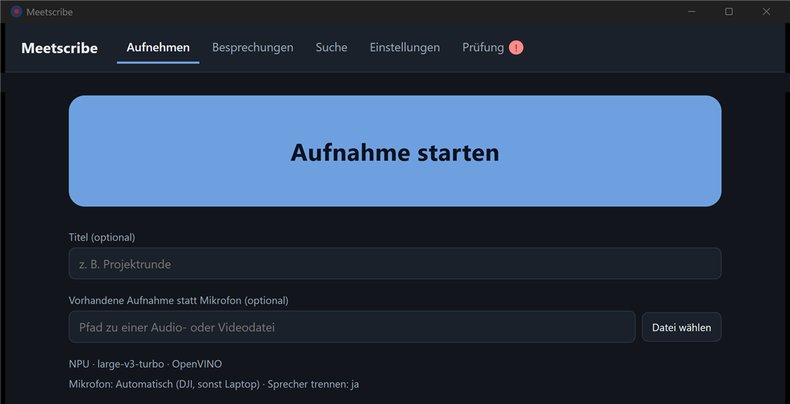

# meetscribe

A Windows app that records meetings, transcribes them locally in German with Whisper large-v3-turbo through OpenVINO and keeps them in a queryable archive.



The UI text, the CLI help and the MCP tool descriptions are German. Code and this README are English.

## What it does

- Records from the laptop microphone, a USB wireless receiver or both, or takes an existing audio or video file (decoded through ffmpeg).
- Transcribes with `openvino_genai.WhisperPipeline` and word timestamps. The default model is `large-v3-turbo`. Hardware is tried in the order NPU, GPU, iGPU, CPU, and a failure during a run continues on the next one unless `--no-fallback` is set. A second backend, faster-whisper, runs on the CPU or on NVIDIA CUDA.
- Separates speakers with pyannote (`pyannote/speaker-diarization-community-1`, run on the CPU) and lets you attach names to the labels. Names are stored apart from the transcript data.
- Archives each meeting as an Arrow IPC file while it is written and as a Parquet file after rotation. DuckDB reads both as one view.
- Writes a Markdown report with header data, a participant table (talk time, share, words) and the transcript by speaker. There is no summary and no task list.
- Serves the archive to MCP clients over stdio (`meetscribe-mcp`): search, transcript paging, speaker statistics, transcription jobs for existing files and read-only SQL.

## Architecture

```
Tauri 2 window (TypeScript)
        |  Tauri commands
Rust shell  gui/src-tauri/src
        |  JSON-RPC 2.0 over the child's stdin/stdout
Engine process: meetscribe serve  (Python)
        |  shared service layer: src/meetscribe/service.py
  +-----+---------------------+----------------------+
  | pipeline.py               | store.py             |
  | record, ffmpeg decode,    | hot Arrow IPC, cold  |
  | windowing, Whisper,       | Parquet, speaker map,|
  | pyannote, model setup     | DuckDB views, report |
  | backends.py               +----------------------+
  | catalog, hardware detection, backend selection, fallback

MCP client --stdio--> meetscribe-mcp (mcp_server.py) --> same service layer and archive
```

1. The Rust shell (`engine.rs`, `lib.rs`) starts `meetscribe serve` once as a child process and exchanges JSON-RPC messages with it. Methods include `run.start`, `run.stop`, `run.state`, `download.start`, `meeting.state`, `speakers.set`, `devices`, `models`, `check`, `ping` and `shutdown`; progress arrives as notifications. A fake engine (`gui/src-tauri/examples/fake_engine.rs`) serves the Rust tests.
2. `pipeline.py` decodes audio to mono, cuts it into windows of about 300 s at the quietest point near each boundary, skips windows without signal, transcribes, assigns each word to the speaker with the largest time overlap and merges words into segments (pause limit 1.5 s).
3. `backends.py` holds the model catalog (tiny, base, small, medium, large-v3, large-v3-turbo as OpenVINO fp16 and int8; CT2 variants for faster-whisper), detects NPU, discrete GPU, integrated GPU and CPU through OpenVINO device types, and refuses combinations known not to work, for example int8 on the NPU (`ZE_RESULT_ERROR_DEVICE_LOST`).
4. `store.py` writes `data/hot/<id>.arrow`, archives to `data/cold/year=YYYY/month=MM/<id>.parquet`, keeps the original hot file in `data/archive/`, stores speaker names in `data/speakers.parquet` and builds the DuckDB views `segments`, `segments_named` and `speakers`. File locks guard concurrent starts and writes between the app and the MCP server.
5. `mcp_server.py` exposes 12 tools: `list_meetings`, `search`, `get_transcript`, `get_minutes`, `speaker_stats`, `set_speaker_name`, `transcribe_start`, `transcribe_status`, `transcribe_cancel`, `list_models`, `list_hardware`, `query_sql`. It has no recording and no download tool. `query_sql` accepts exactly one SELECT, runs it in a read-only transaction with `enable_external_access=false`, a 1 GB memory limit, 2 threads, a 20 s timeout, at most 1000 rows and locked configuration.

## Tech stack

- Python 3.12 (`pyproject.toml`, uv): `openvino-genai` 2026.4, `pyannote.audio` 4, `torch` (CPU wheels), `duckdb` 2, `pyarrow`, `mcp` 2.x, `click`, `sounddevice`, `soundfile`, `numpy`, `huggingface_hub`. Optional extra `faster-whisper`. Dev: `pytest`.
- Rust 2021 and Tauri 2, `gui/src-tauri`: `tauri`, `tauri-plugin-dialog`, `serde`, `serde_json`. NSIS installer target.
- TypeScript, `gui/src`: bundled with esbuild, no UI framework. Tests use jsdom and a stub for the Tauri API.
- External program: ffmpeg on the PATH.

## Repository layout

| Path | Purpose |
| --- | --- |
| `src/meetscribe/` | Engine: `cli.py`, `service.py` (service layer and JSON-RPC server), `pipeline.py`, `backends.py`, `store.py`, `mcp_server.py`. |
| `tests/` | pytest suite per engine module, a fake engine process and a socket guard for the MCP session test. |
| `gui/src/` | Front end: `index.html`, `main.ts`, `style.css`. |
| `gui/src-tauri/` | Rust shell, engine child-process handling, Tauri config, Rust tests and the fake engine example. |
| `gui/test/` | jsdom UI tests and Tauri API stubs. |
| `docs/` | Screenshot. |

## Getting started

Requirements: Windows 11 x64, [uv](https://docs.astral.sh/uv/), ffmpeg on the PATH (for example `winget install Gyan.FFmpeg`). The NPU path needs an Intel Core Ultra with the Intel NPU driver installed; without it the engine uses the integrated GPU or the CPU. For speaker separation, accept the terms of `pyannote/speaker-diarization-community-1` on Hugging Face and set a read token in `HF_TOKEN` before `setup`. Rust, Node.js and WebView2 are only needed to build the app.

Engine, run in the project folder. The editable install matters because `models/`, `data/` and `protokolle/` are resolved relative to the project, unless `MEETSCRIBE_MODELS`, `MEETSCRIBE_DATA` and `MEETSCRIBE_REPORTS` are set:

```powershell
uv tool install --editable .
$env:HF_TOKEN = "hf_..."
meetscribe setup
meetscribe check
```

`setup` is the only command that uses the network. It downloads the OpenVINO Whisper models and, when `HF_TOKEN` is set, the diarization model. If the NPU model is installed it also warms the NPU compile cache in `models/ov_cache`. `meetscribe --help` lists the other commands, among them `devices`, `models`, `record`, `transcribe` and `run`; `run` records or takes a file, transcribes, asks for speaker names and writes the report.

Selection and locations can be set through options or environment variables:

| Setting | Values or default |
| --- | --- |
| `MEETSCRIBE_BACKEND` | `auto`, `openvino`, `faster-whisper` (default `auto`) |
| `MEETSCRIBE_DEVICE` | `auto`, `npu`, `gpu`, `igpu`, `cpu` (default `auto`) |
| `MEETSCRIBE_MODELS` | Model directory, default `models/` in the project |
| `MEETSCRIBE_DATA` | Archive directory, default `data/` in the project |
| `MEETSCRIBE_REPORTS` | Report directory, default `protokolle/` in the project |
| `HF_TOKEN` | Hugging Face read token, used by `setup` only |

Archive layout:

| Path | Content |
| --- | --- |
| `data/hot/<id>.arrow` | Meeting being written or not yet rotated, Arrow IPC |
| `data/cold/year=YYYY/month=MM/<id>.parquet` | Archived meeting, Parquet |
| `data/archive/<id>.arrow` | Original hot file kept after archiving |
| `data/speakers.parquet` | Speaker names per meeting and label |

App:

```powershell
cd gui
npm ci
npm run build
npm run tauri build
```

The build produces `gui/src-tauri/target/release/meetscribe-gui.exe` and an NSIS installer. The installer contains only the app; the app finds the engine through its settings, the project folder, the PATH or `uv`. MCP clients start `meetscribe-mcp`; the app shows the matching registration command in its settings.

Tests:

```powershell
uv run pytest -q
cd gui; npm test
cd gui/src-tauri; cargo test
```

`cargo test` needs `gui/dist`, which `npm run build` creates. The suites contain 44 UI tests and 34 Rust tests. The Python tests use stand-ins for audio devices, models and the network.

## Status and limitations

- Version 0.1.0, a prototype. No CI workflow exists in the repository.
- Whisper inference runs locally on the NPU, GPU, iGPU or CPU, depending on the selection. Diarization runs on the CPU. No cloud service is called after `setup`.
- Not covered by automated tests: real microphone capture, the real pyannote model, the model download against the network and keep-awake behaviour. The tests use stand-ins for these.
- Models other than large-v3-turbo and small are marked as unverified on the NPU in the catalog.
- Speaker labels (`SPEAKER_00`, ...) are valid within one meeting only. Each word belongs to one speaker, so overlapping speech is not resolved.
- Transcription accuracy is not measured in this repository. Check names, terms and numbers before use.
- Recordings, transcripts, reports and speaker names are stored unencrypted. Audio is not deleted automatically. Obtain consent before recording.
- Transcript text returned through MCP is untrusted input for the client; the server instructions say so.
- The Rust crate has a mobile entry point, but no mobile build is provided.

## License

GPL-3.0-or-later, see [LICENSE](LICENSE).
